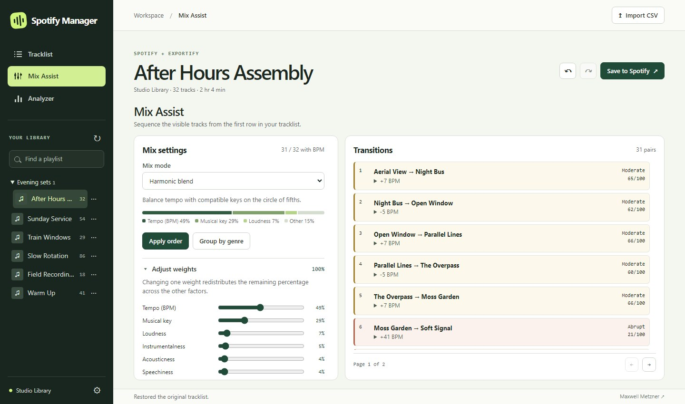
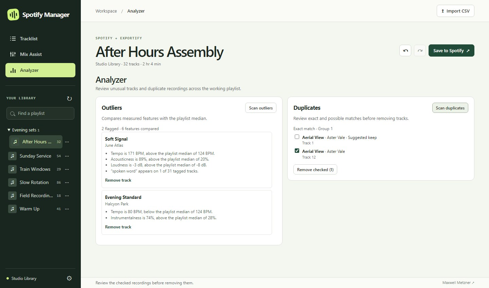

# Spotify Manager

Spotify Manager is a static playlist editor for GitHub Pages. Open a playlist from Spotify or import an Exportify CSV directly in the browser.

## Open a playlist

**Spotify library.** Choose **Connect Spotify** to open the setup guide. Create a Spotify app with Web API access, register the redirect URI shown in settings, save its Client ID, and sign in. Search your library or use the menu beside a playlist to assign it to a local folder. Folder assignments are saved in this browser for the connected account. Spotify’s Web API does not expose the folder hierarchy from its apps. [Spotify playlist folders](https://developer.spotify.com/documentation/web-api/concepts/playlists#folders)

**Exportify CSV.** Choose **Import CSV** to open Exportify, export an individual playlist, and drop its CSV into the importer. A CSV can open on its own while signed out. With a Spotify playlist already open, the importer can match recordings by Spotify URI and add their metadata while preserving edits, repeated entries, and working order. It reports the match count and leaves unmatched tracks in place. [Exportify](https://exportify.net/) · [Export format](https://github.com/pavelkomarov/exportify#export-format)

| Available data | What you can do |
| --- | --- |
| Spotify playlist and track details | Search, sort, filter, reorder, remove tracks, review duplicates, and save a new private playlist. |
| Tempo, key, loudness, and other audio measurements | Use Mix Assist, inspect adjacent transitions, and compare tracks with their playlist median. Exportify supplies these fields when available. |
| Genre tags | Filter by genre or sequence within each primary genre. |

## Tracklist

The grid renders a window of rows and columns. Search across titles, artists, and albums. Click a header to sort, or use its filter icon or context menu to include or exclude values. Duration filters accept minutes and seconds such as `3:45` or a number of seconds. Added times appear in the browser’s local time zone and sort chronologically.

Drag and resize headers, pick visible columns, or use **Actions** to shuffle, restore the original tracklist, and remove selected occurrences. Undo and redo work on the current playlist. **Save to Spotify** previews a new private playlist in visible table order, including active filters. If sign-in is needed, the app keeps the open work in this tab through the OAuth round trip.


## Mix Assist

| Mode | BPM weight | Other priorities |
| --- | ---: | --- |
| Beatmatch | 68% | Key and loudness, with small weights for texture. |
| Harmonic blend | 48% | Compatible keys on the circle of fifths. |
| Acoustic flow | 42% | Acousticness, instrumentalness, speechiness, and loudness. |

Open **Adjust weights** to customize a mode or save a preset in the browser. The adjusted slider keeps its percentage and the others share the remainder. The total stays at 100%. Artist spacing has a separate, adjustable penalty. The initial Beatmatch weights can be configured in `config/mix-weights.json`.

Sequencing runs in a worker, starting from the visible track order. Filters keep hidden entries in their existing positions. Tracks without comparable weighted measurements keep their slots. Transition cards show a quality label, BPM change, and any half-time or double-time match. Expand a card’s tempo line for the pair fit, key compatibility, genre overlap, artist adjustment, and coverage. Sparse pairs are labeled **Limited data**.



## Analyzer

**Outliers** scans features measured on at least six tracks. It compares values with the playlist median using robust spread estimates and a minimum meaningful difference per feature. A strong difference in tempo, loudness, or texture can trigger a flag on its own. Smaller differences need corroboration from a second feature. Genre rarity adds context to an existing flag. Each result includes the track’s measurements and the playlist medians.

**Duplicates** groups repeated and closely related recordings by title and artist. Review suggested keeps and checked occurrences before applying a removal. Scans use the entire working playlist. Results are paged inside scrollable panels.



## Hosting and authentication

OAuth uses Authorization Code with PKCE. The app stores its Client ID and tokens in browser storage. Spotify authentication requests these scopes.

- `playlist-read-private`
- `playlist-read-collaborative`
- `playlist-modify-private`
- `playlist-modify-public`
- `user-read-private`

### Local preview

```powershell
npm start
```

Open `http://127.0.0.1:3000/`. For local Spotify sign-in, register the exact redirect URI shown in Spotify settings.

### GitHub Pages

1. In the repository’s **Settings → Pages**, set **Source** to **GitHub Actions**.
2. Push to `main` or run **Deploy GitHub Pages** manually.
3. Open `https://<your-user>.github.io/<your-repo>/` and register the callback below in the Spotify Developer Dashboard.
4. Open Spotify settings in the app, paste your Client ID, and connect.

```text
https://<your-user>.github.io/<your-repo>/api/auth/spotify/callback
```

For another static host, serve `index.html`, `src/`, `config/`, and `api/auth/spotify/callback/` under the same base path. The application ships Tabulator 6.3.1 and its MIT license in `src/vendor/tabulator/`.

### Tests

```powershell
npm test
```

<details>
<summary>Workspace artwork</summary>

The opening image was generated with the built-in ImageGen tool and saved as `src/renderer/assets/record-sleeve.webp`. The generation prompt was “Editorial product photograph for a playlist editor. Top-down close crop of a black vinyl record slipping out of an unprinted acid-lime paper sleeve on a deep forest-green tabletop, arranged diagonally. Raking studio light catches the fine concentric grooves. A plain pale green center label and spindle hole. Graphic, tactile, restrained. Landscape composition, no text, logos or people.”

</details>
