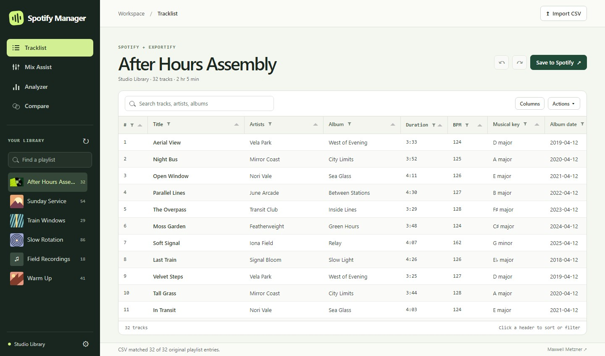
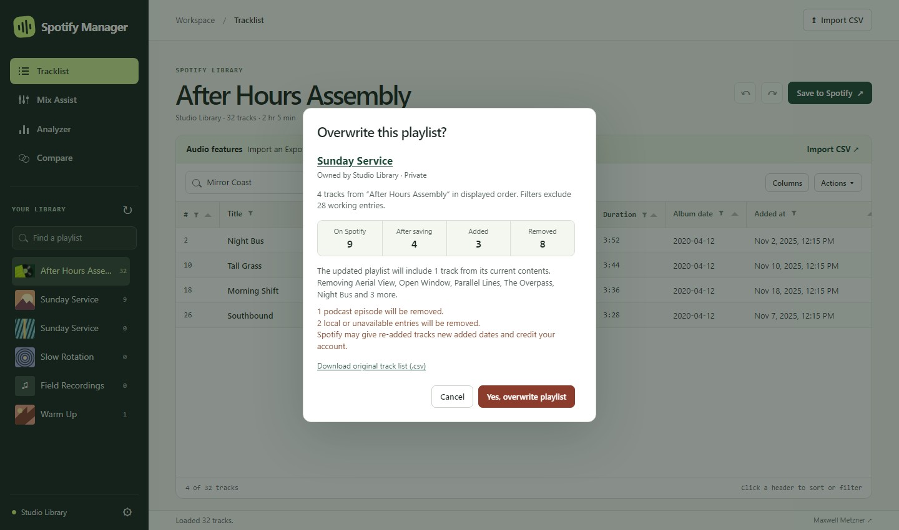
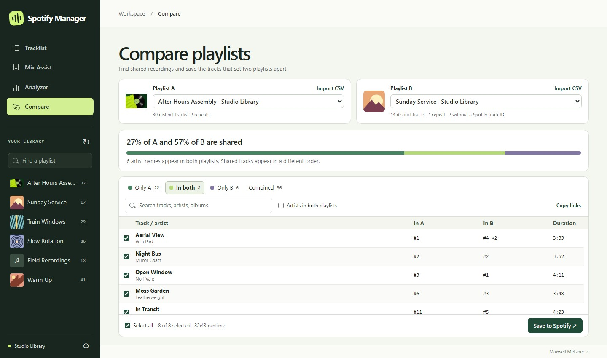

# Spotify Manager

Spotify Manager is a static playlist editor for GitHub Pages. Open a playlist from Spotify or import an Exportify CSV directly in the browser.

## Open a playlist

**Spotify library.** Choose **Connect Spotify** to open the setup guide. Create a Spotify app with Web API access, register the redirect URI shown in settings, save its Client ID, and sign in. Browse your playlists in library order with their cover images, or search by name.

**Exportify CSV.** Choose **Import CSV** to open Exportify, export an individual playlist, and drop its CSV into the importer. A CSV can open on its own while signed out. With a Spotify playlist already open, the importer can match recordings by Spotify URI and add their metadata while preserving edits, repeated entries, and working order. It reports the match count and leaves unmatched tracks in place. [Exportify](https://exportify.net/) · [Export format](https://github.com/pavelkomarov/exportify#export-format)

| Available data | What you can do |
| --- | --- |
| Spotify playlist and track details | Search, sort, filter, reorder, remove tracks, review duplicates, and save to a new or existing playlist. |
| Tempo, key, loudness, and other audio measurements | Use Mix Assist, inspect adjacent transitions, and compare tracks with their playlist median. Exportify supplies these fields when available. |
| Genre tags | Filter by genre or sequence within each primary genre. |

## Tracklist

The grid renders a window of rows and columns. Search across titles, artists, and albums. Click a header to sort, or use its filter icon or context menu to include or exclude values. Duration filters accept minutes and seconds such as `3:45` or a number of seconds. Added times appear in the browser’s local time zone and sort chronologically.

Drag and resize headers, pick visible columns, or use **Actions** to shuffle, restore the original tracklist, and remove selected occurrences. Undo and redo work on the current working copy. **Save to Spotify** defaults to creating a new private playlist in visible table order, including active filters. If sign-in is needed, the app reopens the working copy and save preview in the same tab.



## Overwrite an existing playlist

Choose **Save to Spotify → Overwrite an existing playlist** to update a playlist at its existing Spotify link. Pick one you own or can edit as a collaborator. If a Tracklist filter hides tracks, the default is the whole working playlist in working order. Choose **Filtered tracks in displayed order** to save just the visible selection. In Compare, the source is the checked recordings in the current results.

Choose **Review overwrite** to read the destination from Spotify. The confirmation shows its name and owner, the before and after counts, and entries added or removed, including repeated occurrences. It calls out order-only changes, episodes and local files, and lets you download the original track list as a CSV. Only **Yes, overwrite playlist** applies the edit. A deliberately emptied working playlist has a separate **Yes, clear playlist** confirmation.



Large comparisons can span several playlists. Select up to 10,000 tracks for each Spotify destination. [Spotify’s playlist size guidance](https://community.spotify.com/forum/en/discussion/7561048/unable-to-add-tracks-to-liked-songs-and-playlists-on-ios)

Spotify accepts up to 100 track URIs per request. The app checks the destination version before each batch and stops if it detects a change. An interrupted save can leave part of the new list on Spotify. Choose **Review current version** to inspect it before confirming again. If the existing entries match the start of the proposed list, the app appends only the remaining tracks. If it can reproduce the requested order with one block move, it uses Spotify’s native reorder to preserve added dates and contributor credits. The review flags replacements that may change those details. [Update playlist items](https://developer.spotify.com/documentation/web-api/reference/reorder-or-replace-playlists-items) · [Add items to a playlist](https://developer.spotify.com/documentation/web-api/reference/add-items-to-playlist)

## Mix Assist

| Mode | BPM weight | Other priorities |
| --- | ---: | --- |
| Beatmatch | 68% | Key and loudness, with small weights for texture. |
| Harmonic blend | 48% | Compatible keys on the circle of fifths. |
| Acoustic flow | 42% | Acousticness, instrumentalness, speechiness, and loudness. |

Open **Adjust weights** to customize a mode or save a preset in the browser. The adjusted slider keeps its percentage and the others share the remainder. The total stays at 100%. Artist spacing has a separate, adjustable penalty. The initial Beatmatch weights can be configured in `config/mix-weights.json`.

Sequencing runs in a worker, starting from the visible track order. Filters keep hidden entries in their existing positions. Tracks without comparable weighted measurements keep their slots.

Scroll through **Transitions** to review every adjacent pair in order. Cards show a quality label, BPM change, and any half-time or double-time match. Expand a card’s tempo line for the pair fit, key compatibility, genre overlap, artist adjustment, and coverage. Sparse pairs are labeled **Limited data**. Mix Assist scores and renders cards near the scroll position and remembers which details you opened as you scroll.


## Analyzer

**Outliers** scans features measured on at least six tracks. It compares values with the playlist median using robust spread estimates and a minimum meaningful difference per feature. A strong difference in tempo, loudness, or texture can trigger a flag on its own. Smaller differences need corroboration from a second feature. Genre rarity adds context to an existing flag. Each result includes the track’s measurements and the playlist medians.

**Duplicates** groups repeated and closely related recordings by title and artist. Review suggested keeps and checked occurrences before applying a removal. Scans use the entire working playlist. Results are paged inside scrollable panels.


## Compare playlists

Open **Compare** and choose a source for **Playlist A** and **Playlist B**. Each side accepts a Spotify library playlist or an Exportify CSV. Choose **Working copy** on one side and its saved Spotify playlist on the other to check your edits. The working copy uses the full edited tracklist in working order. Comparing two CSVs works while signed out.

**Only A**, **In both**, **Only B**, and **Combined** show distinct recordings matched by Spotify track ID. The overlap percentages use each playlist’s own distinct-track count. The source cards report repeats and entries without a usable ID. Each result shows its first position in each playlist and how many times it occurs there.

Use **Artists in both playlists** with **Only A** or **Only B** to find different songs by artists both playlists already feature. Artist matching uses credited names. The comparison also reports whether shared recordings appear in the same relative order. Click a track title to open it in Spotify, or use **Copy links** to take the checked results with you while signed out.

Search or uncheck tracks, then choose **Save to Spotify** to create a private playlist or review an overwrite. The combined list keeps A’s order and appends B’s additional recordings in their original order. The preview uses the checked tracks in the current results. If sign-in is needed, the comparison and its save preview reopen in the same tab.



## Hosting and authentication

OAuth uses Authorization Code with PKCE. The app stores its Client ID and tokens in browser storage. Spotify authentication requests these scopes.

- `playlist-read-private`
- `playlist-read-collaborative`
- `playlist-modify-private`
- `playlist-modify-public`
- `user-read-private`

### Local preview

```powershell
npm start
```

Open `http://127.0.0.1:3000/`. For local Spotify sign-in, register the exact redirect URI shown in Spotify settings.

### GitHub Pages

1. In the repository’s **Settings → Pages**, set **Source** to **GitHub Actions**.
2. Push to `main` or run **Deploy GitHub Pages** manually.
3. Open `https://<your-user>.github.io/<your-repo>/` and register the callback below in the Spotify Developer Dashboard.
4. Open Spotify settings in the app, paste your Client ID, and connect.

```text
https://<your-user>.github.io/<your-repo>/api/auth/spotify/callback
```

For another static host, serve `index.html`, `src/`, `config/`, and `api/auth/spotify/callback/` under the same base path. The application ships Tabulator 6.3.1 and its MIT license in `src/vendor/tabulator/`.

### Tests

```powershell
npm test
```

<details>
<summary>Workspace artwork</summary>

The opening image was generated with the built-in ImageGen tool and saved as `src/renderer/assets/record-sleeve.webp`. The generation prompt was “Editorial product photograph for a playlist editor. Top-down close crop of a black vinyl record slipping out of an unprinted acid-lime paper sleeve on a deep forest-green tabletop, arranged diagonally. Raking studio light catches the fine concentric grooves. A plain pale green center label and spindle hole. Graphic, tactile, restrained. Landscape composition, no text, logos or people.”

</details>
